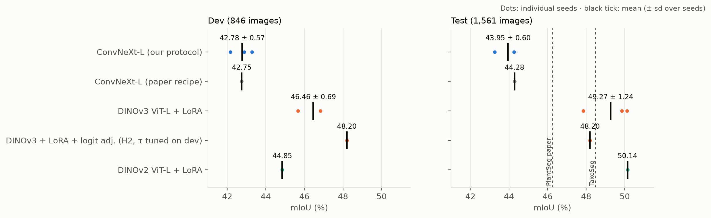
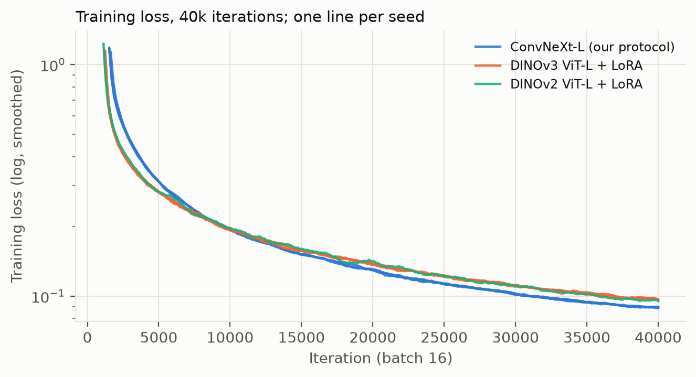
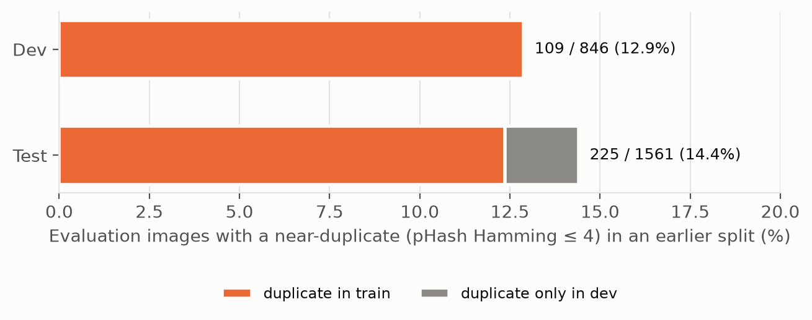
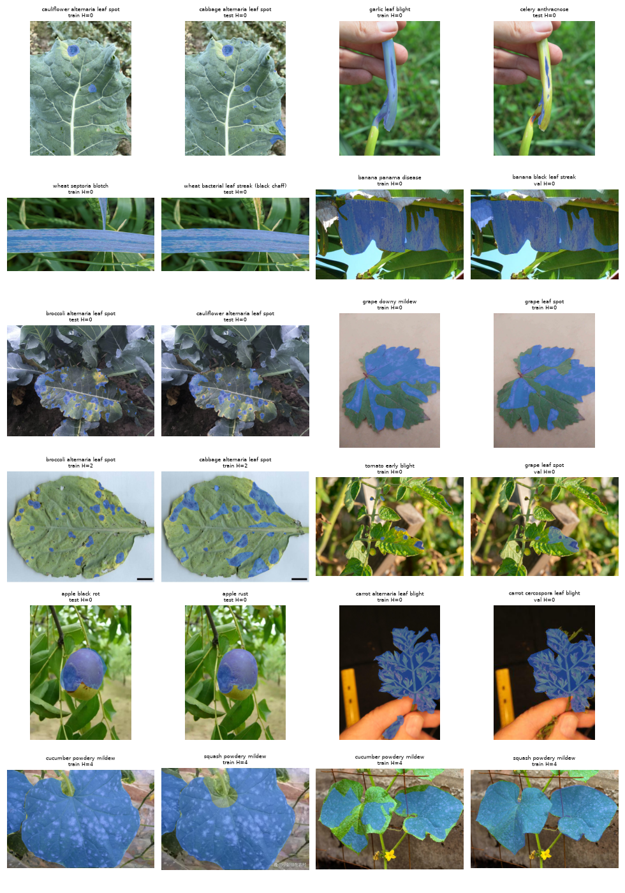
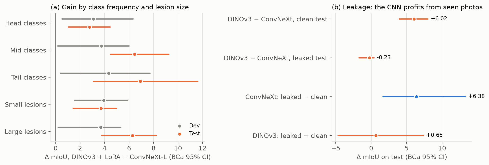
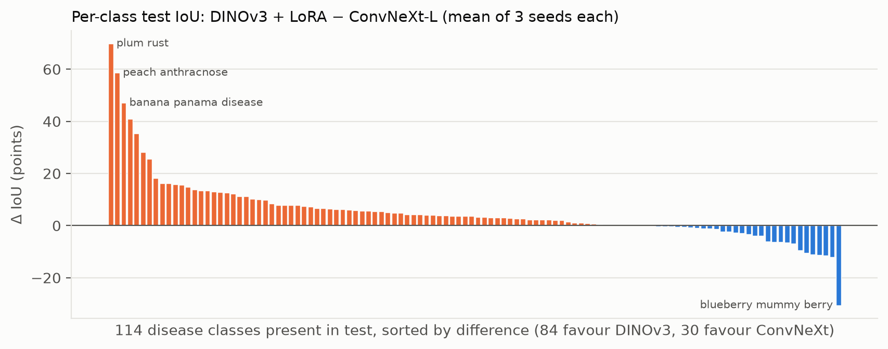
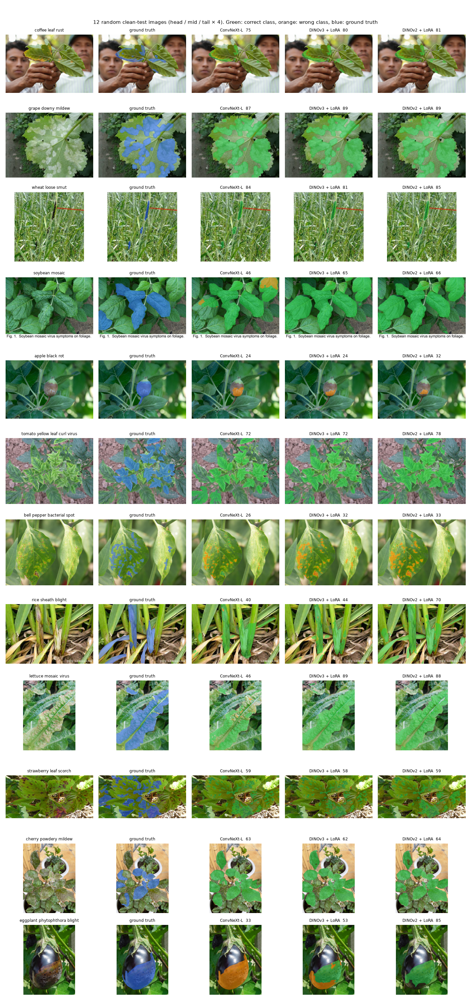
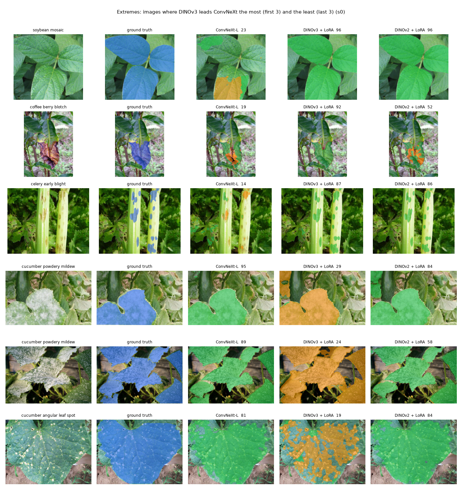

# Leakage-aware evaluation of DINOv3 + LoRA for plant disease segmentation

Fatih Aydost, Karabük University, 2026

We adapt the DINOv3 ViT-L foundation model to PlantSeg with LoRA and compare it with a fully fine-tuned ConvNeXt-L under the same training budget. We also audit PlantSeg for near-duplicate images shared between splits and re-evaluate both models with and without them.

With three seeds each, DINOv3 + LoRA reaches 49.27 ± 1.24 test mIoU and ConvNeXt-L 43.95 ± 0.60, a difference of +5.3 (BCa 95% CI [3.7, 7.3], p < 0.001). 14.4% of the test images have a near-duplicate in train or dev, and 244 near-duplicate pairs carry different disease labels. On the clean test images DINOv3 leads by +6.0; on the leaked ones the two models tie, because ConvNeXt scores 6.4 points higher on photographs it saw during training and DINOv3 does not. DINOv2 ViT-L + LoRA performs about as well as DINOv3, so the gain comes from a foundation model adapted with LoRA rather than from DINOv3 in particular.

<p align="center"></p>

The H2 run is the highest point on dev because its τ was picked there. On test it scores below the DINOv3 + LoRA mean, so the pre-registered H2 gain did not hold (see Hypotheses).

## Setup

| | |
|---|---|
| Task | Semantic segmentation with 116 classes (115 diseases and background) |
| Data | PlantSeg v7 (Wei et al., *Scientific Data* 2026), 7,774 field photographs, official split of 5,367 train, 846 dev and 1,561 test images |
| Proposed model | DINOv3 ViT-L/16, LoRA with rank 16 on attention qkv and output projection, lightweight UperNet head; 14.1 M trainable parameters |
| Baselines | ConvNeXt-L with the same head and full fine-tuning (208 M trainable, 3 seeds); ConvNeXt-L trained with the dataset paper's recipe; frozen DINOv3; DINOv2 ViT-L + LoRA |
| Training | 40k iterations at batch 16 (the dataset paper's schedule), 512 crops, bf16, AdamW at lr 2e-4 with weight decay 0.01, 300 warm-up iterations, poly decay, backbone lr × 0.1 |
| Evaluation | Short side resized to 512, whole-image inference without TTA, mmseg `IoUMetric` semantics |
| Protocol | Pre-registered before the first run ([`docs/preregistration.md`](docs/preregistration.md)). Every choice was made on dev, and every deviation is listed in [`docs/deviations.md`](docs/deviations.md) |
| Statistics | Paired bootstrap over images, B = 5,000, BCa 95% intervals |
| Compute | 44.8 A100-hours for the nine large runs (3.7 to 6.8 h each), plus Kaggle T4 time for the frozen run and the τ sweep |

## Hypotheses

| | Pre-registered hypothesis | Result | Evidence |
|---|---|---|---|
| H1 | At equal budget, DINOv3 + LoRA beats the strongest CNN | Supported for LoRA. The frozen variant named in the pre-registration was not (42.48 vs 42.78 dev) | Test +5.32 [3.73, 7.34] over ConvNeXt-L and +4.99 over the paper recipe. The worst DINOv3 seed (47.85) beats the best CNN seed (44.34). Dev +3.69 |
| H2 | Foreground logit adjustment (τ = 0.5) helps tail classes | Not supported | Dev +1.31 [−0.31, 3.31] against a +1.5 threshold; test +0.34, p = 0.65 |
| H3 | Gains are larger for small lesions and tail classes | Partly, on test only (exploratory) | Tail minus head +4.14 [0.08, 9.26], p = 0.045 on test, p = 0.73 on dev. Small lesions show no larger gain |
| | The gain is specific to DINOv3 | Not supported | DINOv3 49.27 vs DINOv2 50.14 on test (p = 0.11); the sign flips on dev |
| | Near-duplicates distort the comparison | Supported on test, not on dev | Interaction +5.73 [3.66, 8.74], p < 0.001 |

## Results

Test mIoU in %. Clean means the 1,336 test images with no near-duplicate in train or dev; leaked means the other 225. Where a model has several seeds, the numbers are seed means.

| Model | Seeds | Test | Clean | Leaked | Tail classes | mAcc | Dev |
|---|---|---|---|---|---|---|---|
| ConvNeXt-L, our protocol | 43.25 · 44.34 · 44.26 | 43.95 ± 0.60 | 42.59 | 45.78 | 39.8 | 54.6 | 42.78 ± 0.57 |
| ConvNeXt-L, paper recipe | 44.28 | 44.28 | 43.08 | 46.18 | 40.2 | 56.4 | 42.75 |
| DINOv3 ViT-L, frozen | | | | | | | 42.48 |
| DINOv3 ViT-L + LoRA | 47.85 · 50.11 · 49.85 | **49.27 ± 1.24** | **48.61** | 45.55 | 46.7 | 60.1 | **46.46 ± 0.69** |
| DINOv3 + LoRA + logit adjustment (H2) | 48.20 | 48.20 | 47.99 | 46.28 | 46.0 | 61.5 | 48.20 |
| DINOv2 ViT-L + LoRA | 50.14 | 50.14 | 49.27 | 46.34 | 49.9 | 60.3 | 44.85 |

Clean and leaked scores use only the classes present in that subset's ground truth (115 and 76 classes). The frozen DINOv3 run was trained on Kaggle T4s and evaluated on dev only.

Frozen DINOv3 matches the fully trained ConvNeXt-L on dev (42.5 vs 42.8), and LoRA adds 4.0 points. Our CNN protocol and the paper's recipe give the same dev score (42.78 vs 42.75), so the baseline was not weakened by our training setup. The reproduced paper recipe scores 44.28 on test against the 46.24 reported in the dataset paper.

<details>
<summary>Per-run results (generated by <code>analysis/tables.py</code>)</summary>

**Dev**

<!-- RUN-TABLE:BEGIN -->
| Run | Model | mIoU | mAcc | Tail | Small lesion | Clean | Leaked | Train (h) | GPU |
|---|---|---|---|---|---|---|---|---|---|
| `a_v3L_lora_s0` | DINOv3 ViT-L + LoRA, s0 | **46.89** | 57.99 | 39.03 | 39.79 | 46.96 | 48.53 | 4.84 | A100-80GB |
| `b_cnxL_s0` | ConvNeXt-L, our protocol, s0 | **42.16** | 52.34 | 33.83 | 36.58 | 41.96 | 48.36 | 3.72 | A100-80GB |
| `c_cnxL_mak_s0` | ConvNeXt-L, paper recipe (reproduction), s0 | **42.75** | 54.15 | 33.41 | 36.68 | 42.71 | 48.00 | 6.79 | A100-80GB |
| `d_v3L_lora_s1` | DINOv3 ViT-L + LoRA, s1 | **46.83** | 58.26 | 38.49 | 41.04 | 46.89 | 48.88 | 5.32 | A100-40GB |
| `e_v3L_lora_s2` | DINOv3 ViT-L + LoRA, s2 | **45.67** | 56.35 | 37.92 | 39.56 | 45.53 | 47.95 | 5.16 | A100-40GB |
| `f_cnxL_s1` | ConvNeXt-L, our protocol, s1 | **43.29** | 53.41 | 34.12 | 36.20 | 43.05 | 48.40 | 3.96 | A100-40GB |
| `g_cnxL_s2` | ConvNeXt-L, our protocol, s2 | **42.88** | 53.48 | 34.50 | 35.83 | 42.52 | 47.96 | 4.21 | A100-80GB |
| `h_v2L_lora_s0` | DINOv2 ViT-L + LoRA, s0 | **44.85** | 56.77 | 35.41 | 39.93 | 45.24 | 49.18 | 5.54 | A100-80GB |
| `i_H2_s0` | H2: DINOv3 ViT-L + LoRA + foreground logit adjustment, s0 | **48.20** | 61.50 | 42.14 | 41.65 | 49.19 | 47.99 | 5.31 | A100-40GB |
<!-- RUN-TABLE:END -->

**Test**

<!-- TEST-TABLE:BEGIN -->
| Run | Model | mIoU | mAcc | Tail | Small lesion | Clean | Leaked | Train (h) | GPU |
|---|---|---|---|---|---|---|---|---|---|
| `a_v3L_lora_s0` | DINOv3 ViT-L + LoRA, s0 | **47.85** | 58.18 | 44.18 | 41.70 | 46.58 | 45.99 | 4.84 | A100-80GB |
| `b_cnxL_s0` | ConvNeXt-L, our protocol, s0 | **43.25** | 53.79 | 38.00 | 38.59 | 42.24 | 45.82 | 3.72 | A100-80GB |
| `c_cnxL_mak_s0` | ConvNeXt-L, paper recipe (reproduction), s0 | **44.28** | 56.44 | 40.16 | 38.34 | 43.08 | 46.18 | 6.79 | A100-80GB |
| `d_v3L_lora_s1` | DINOv3 ViT-L + LoRA, s1 | **50.11** | 61.19 | 48.57 | 43.27 | 49.56 | 45.27 | 5.32 | A100-40GB |
| `e_v3L_lora_s2` | DINOv3 ViT-L + LoRA, s2 | **49.85** | 60.78 | 47.39 | 43.37 | 49.69 | 45.39 | 5.16 | A100-40GB |
| `f_cnxL_s1` | ConvNeXt-L, our protocol, s1 | **44.34** | 54.92 | 41.70 | 38.39 | 42.75 | 45.95 | 3.96 | A100-40GB |
| `g_cnxL_s2` | ConvNeXt-L, our protocol, s2 | **44.26** | 54.99 | 39.69 | 40.25 | 42.79 | 45.58 | 4.21 | A100-80GB |
| `h_v2L_lora_s0` | DINOv2 ViT-L + LoRA, s0 | **50.14** | 60.34 | 49.87 | 43.13 | 49.27 | 46.34 | 5.54 | A100-80GB |
| `i_H2_s0` | H2: DINOv3 ViT-L + LoRA + foreground logit adjustment, s0 | **48.20** | 61.47 | 46.02 | 41.77 | 47.99 | 46.28 | 5.31 | A100-40GB |
<!-- TEST-TABLE:END -->

Run ids: `a, d, e` DINOv3 seeds 0 to 2; `b, f, g` ConvNeXt-L seeds 0 to 2; `c` paper recipe; `h` DINOv2; `i` H2.

<p align="center"></p>
</details>

### Bootstrap comparisons

`analysis/stats.py` resamples images and averages over seeds within each model. Brackets are BCa 95% intervals, and p is the smallest α at which the interval excludes 0. Clean-versus-leaked contrasts use the 76 classes present in both subsets and resample within each subset.

| Comparison | Test | Dev |
|---|---|---|
| DINOv3 − ConvNeXt (ours), all images | **+5.32** [3.73, 7.34] p<0.001 | **+3.69** [1.58, 5.36] p=0.001 |
| DINOv3 − ConvNeXt (ours), clean images | **+6.02** [3.94, 8.00] p<0.001 | **+3.95** [1.35, 5.55] p=0.011 |
| DINOv3 − ConvNeXt (ours), leaked images | −0.23 [−1.72, 0.39] p=0.21 | +0.21 [−1.20, 1.27] p=0.93 |
| Leakage interaction (clean gap − leaked gap) | **+5.73** [3.66, 8.74] p<0.001 | +1.67 [−2.00, 4.39] p=0.43 |
| H2 − DINOv3 (same seed), all images | +0.34 [−0.87, 1.64] p=0.65 | +1.31 [−0.31, 3.31] p=0.10 |

<details>
<summary>All comparisons (paper recipe, DINOv2, clean and leaked subsets)</summary>

| Test | All (1,561) | Clean (1,336) | Leaked (225) |
|---|---|---|---|
| DINOv3 − ConvNeXt (ours) | **+5.32** [3.73, 7.34] p<0.001 | **+6.02** [3.94, 8.00] p<0.001 | −0.23 [−1.72, 0.39] p=0.21 |
| DINOv3 − ConvNeXt (paper recipe) | **+4.99** [2.67, 7.08] p<0.001 | **+5.53** [2.78, 7.76] p<0.001 | −0.63 [−2.10, 0.19] p=0.093 |
| H2 − DINOv3 (same seed) | +0.34 [−0.87, 1.64] p=0.65 | **+1.41** [0.35, 3.42] p=0.015 | +0.29 [−0.54, 1.84] p=0.35 |
| DINOv3 (3 seeds) − DINOv2 | −0.87 [−3.03, 0.32] p=0.11 | −0.66 [−3.00, 0.68] p=0.20 | −0.79 [−1.74, 0.08] p=0.069 |
| DINOv3 − DINOv2 (same seed) | **−2.29** [−4.82, −1.22] p<0.001 | **−2.68** [−5.21, −1.74] p<0.001 | −0.35 [−1.50, 0.91] p=0.52 |
| DINOv2 − ConvNeXt (ours) | **+6.19** [5.04, 8.88] p<0.001 | **+6.67** [5.14, 9.70] p<0.001 | +0.55 [−1.09, 1.41] p=0.75 |

| Dev | All (846) | Clean (737) | Leaked (109) |
|---|---|---|---|
| DINOv3 − ConvNeXt (ours) | **+3.69** [1.58, 5.36] p=0.001 | **+3.95** [1.35, 5.55] p=0.011 | +0.21 [−1.20, 1.27] p=0.93 |
| DINOv3 − ConvNeXt (paper recipe) | **+3.71** [1.36, 5.61] p=0.002 | **+3.75** [0.91, 5.50] p=0.005 | +0.45 [−1.79, 2.39] p=0.57 |
| H2 − DINOv3 (same seed) | +1.31 [−0.31, 3.31] p=0.10 | **+2.23** [1.06, 4.79] p=0.003 | −0.54 [−3.09, 1.07] p=0.47 |
| DINOv3 (3 seeds) − DINOv2 | **+1.61** [0.12, 4.21] p=0.037 | +1.22 [−0.69, 3.86] p=0.18 | −0.73 [−3.88, 1.78] p=0.56 |
| DINOv3 − DINOv2 (same seed) | **+2.03** [0.66, 4.97] p=0.010 | +1.72 [−0.16, 4.88] p=0.069 | −0.66 [−3.88, 1.92] p=0.58 |
| DINOv2 − ConvNeXt (ours) | +2.08 [−0.48, 3.22] p=0.18 | +2.73 [−0.04, 4.03] p=0.095 | +0.94 [−1.89, 4.28] p=0.66 |

</details>

The DINOv3 versus DINOv2 difference is significant with the same seed on both splits, in opposite directions. The H2 gain on clean images is exploratory because τ was chosen on dev. Two rows (H2 clean, DINOv3 − DINOv2 same seed) are significant under BCa but not under percentile intervals and should be read with caution.

## Near-duplicates in PlantSeg

`src/leakage.py` compares perceptual hashes (pHash) of all 7,774 images and calls two images duplicates at Hamming distance 4 or less.

<p align="center"></p>

| Split | Images | Duplicate in train | Duplicate in dev | Leaked | Rate |
|---|---|---|---|---|---|
| Dev | 846 | 109 | n/a | 109 | 12.9% |
| Test | 1,561 | 193 | 43 | 225 | 14.4% |

The dataset contains 813 near-duplicate pairs. 569 share a class and 244 have different labels, covering 399 images; in 150 of those pairs even the plant differs. For example, `apple_black_rot_80` and `grape_black_rot_42` are the same photograph with different masks.

We checked the matcher on 60 of the 244 contradictory pairs: 32 random pairs at Hamming 0 and all 28 pairs at Hamming 2 to 4, from 52 distinct photo clusters. A human rater and an LLM rater (Claude, shown the same sheets) answered one question per pair, whether it is the same photograph. Both said yes for all 60 pairs, which puts the Wilson 95% lower bound for the same-photo rate at 0.94 per pair and 0.93 per cluster. The audit tools and answers are in `analysis/label_audit*.py`, `analysis/label_agreement.py` and `results/label_audit/`.

A single photograph cannot show two host species, so some contradictions can be settled without a plant pathologist (`analysis/host_conflict.py`). In 97 of the 244 pairs the host species differ, which means at least one of the two labels is wrong. These pairs cover 168 images; the most common are cucumber and zucchini (26), rice and ginger (10), and tomato and potato (9). Another 53 pairs name different cultivars of one species, such as broccoli and cabbage. The remaining 94 show the same plant with different diseases, and we do not judge those. 26 of the host conflicts cross test and train, 8 cross test and dev.

On test, the interaction between model and subset is +5.73 [3.66, 8.74], p < 0.001. On the 76 classes present in both subsets, ConvNeXt scores 6.38 [1.67, 13.29] points higher on leaked images than on clean ones (p = 0.012), while DINOv3 gains only 0.65 (p = 0.62). On dev the interaction is not significant (+1.67, p = 0.43).

Exact duplicates were reported earlier in PlantSeg issue [#11](https://github.com/tqwei05/PlantSeg/issues/11) (265 groups, 70 between test and train). Our list contains all 290 of those pairs at Hamming 0 and adds 135 leaked test images. The clean and leaked image lists are in [`results/leakage.json`](results/leakage.json) for anyone who wants to report clean-test scores.

<p align="center"></p>

## Where the gain comes from

<p align="center"></p>

`analysis/extra_analysis.py` splits classes into thirds by training-image count (head, mid, tail) and images at the median mask ratio (small and large lesions).

| DINOv3 − ConvNeXt | Head | Mid | Tail | Tail − head | Small lesion | Large lesion | Small − large |
|---|---|---|---|---|---|---|---|
| Test | +2.78 | +6.45 | +6.91 | +4.14 [0.08, 9.26] p=0.045 | +3.70 | +6.27 | −1.15 [−4.14, 1.86] p=0.46 |
| Dev | +3.09 | +3.73 | +4.33 | +1.24 [−3.88, 5.31] p=0.73 | +3.93 | +3.68 | +0.29 [−3.01, 4.34] p=0.71 |

Part of the gain is localisation and part is naming the disease. Class-agnostic foreground IoU is 70.7 for DINOv3, 71.0 for DINOv2, 68.7 for the paper recipe and 67.0 for ConvNeXt (DINOv3 − ConvNeXt +3.6 [2.3, 5.9]). Image-level disease accuracy, taking the majority foreground class, is 82.4% for DINOv3, 81.4% for DINOv2 and 79.6% for ConvNeXt (+2.8 [1.6, 4.0]).

<p align="center"></p>

The figures below show random clean-test images (four each from head, mid and tail classes) and the images where DINOv3 leads or trails ConvNeXt most (`analysis/qualitative.py`). Blue is the ground truth, green a predicted lesion with the correct disease and orange a predicted lesion with a wrong disease; the number is the image's mIoU. In the extreme cases the masks usually sit in the right place and the models differ in which disease they name.

<p align="center"></p>
<p align="center"></p>

## Published results on PlantSeg

A search of Scopus, Web of Science, Semantic Scholar, OpenAlex, Hugging Face and GitHub in October 2026 found no earlier work that applies DINOv2 or DINOv3 to PlantSeg segmentation.

| Work | Method | Test mIoU |
|---|---|---|
| This work | DINOv3 ViT-L + LoRA, 3 seeds | 49.27 ± 1.24 |
| This work | DINOv2 ViT-L + LoRA, 1 seed | 50.14 |
| TaxoSeg (Smart Agric. Technol. 2026) | FC-CLIP with taxonomy prototypes | 48.48 |
| PlantSeg paper (Sci. Data 2026) | ConvNeXt-L UperNet | 46.24 |
| CAPBNet (ICIC 2026) | Task-specific network | 44.52 |
| This work | ConvNeXt-L UperNet, paper recipe reproduced | 44.28 |
| PlantFormer (Front. Plant Sci. 2026) | Swin-based | 41.78 |
| STAR-Net (Front. Plant Sci. 2026) | | 41.13 |

Training protocols differ between papers, so we describe our result as on par with the best published number from a simpler method. The controlled comparison is the one in the Results section.

## Repository

```
src/          training and evaluation code (Colab)
notebooks/    01 training on Colab, 02 prediction export, 03 analysis of the committed results (CPU)
kaggle/       Kaggle kernels: τ sweep, frozen DINOv3, clean test
pilot/        pilot study on a 4 GB GPU with ViT-B, code and results
analysis/     tables, bootstrap statistics, figures, label audit
results/      per-run metrics (JSON) and per-image scores (NPZ), statistics, leakage lists, label audit, training curves, figures
docs/         pre-registration (Turkish original and English translation), deviations, pilot report, how to run
```

To reproduce the statistics and figures on a CPU:

```bash
pip install numpy pillow matplotlib
python3 analysis/test_stats.py
python3 analysis/stats.py
python3 analysis/figures.py
```

`analysis/tables.py`, `extra_analysis.py` and `qualitative.py` also need the prepared dataset metadata from `pilot/download.py` and `pilot/prepare.py`. `notebooks/03_results_analysis.ipynb` runs the same steps. For training, copy `src/` and `notebooks/01_train_colab.ipynb` to `MyDrive/plantseg-dinov3-lora/` on Google Drive and run the notebook on an A100; [`docs/running.md`](docs/running.md) has the details. The run queue resumes from checkpoints, and test evaluation stays off until it is enabled explicitly.

## Data, weights and licenses

PlantSeg is by Wei et al., *Scientific Data* 13:205 (2026), [doi:10.1038/s41597-025-06513-4](https://doi.org/10.1038/s41597-025-06513-4), distributed on Zenodo ([17719108](https://zenodo.org/records/17719108)) under CC BY-NC 4.0. It is not included here; `pilot/download.py` fetches it. Please cite the dataset if you use this work.

Checkpoints (55 to 170 MB each) are not in git and will be released on Hugging Face Hub or Zenodo.

The code is MIT licensed ([LICENSE](LICENSE)). Prediction masks, figures that contain dataset photographs and the label-audit sheets are derived from PlantSeg and stay under CC BY-NC 4.0.

## Limitations

The study uses a single dataset. H2, DINOv2 and the paper-recipe baseline have one seed each. H3 and the leakage effect are significant on test but not on dev, and the exploratory analyses are not corrected for multiple comparisons. pHash misses heavily cropped or resized copies, so the leakage counts are lower bounds, and the leaked subset is small (225 images, 76 classes). For same-plant pairs with different disease labels we do not decide which label is correct.
